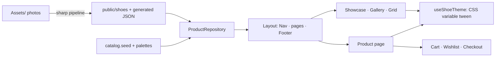

<div align="center">


<br>


**An animation-first sneaker store with a luxury dark look, where the whole page re-colors itself around each shoe.**

[Quick start](#-quick-start) · [Features](#-features) · [Deploy](#-deploy-to-netlify) · [Add shoes](#-adding-shoes) · [Architecture](#-architecture)


</div>

## ✨ Features

<table>
<tr>
<td width="50%" valign="top">

### 🎨 Look and feel

- **Premium dark palette:** obsidian, midnight, espresso and oxblood backgrounds with champagne-gold accents and ivory text
- **Color-reactive theme:** every shoe has its own palette and the page tweens to it with a radial wipe
- **Pinned hero showcase** with scroll, swipe, arrow-key and button control
- **Shared-element flight** from card to product page
- Magnetic buttons, tilt cards, smooth scroll, film grain, custom cursor
- **Real header and footer:** announcement bar, centered logo, blurred sticky nav, mobile menu, newsletter, contact and social links

</td>
<td width="50%" valign="top">

### 🛍️ Store features

- **Product pages** with size picker, sold-out sizes and low-stock label
- **Size guide** modal (EU / UK / US / foot length) and how-to-measure steps
- **Filters and sort:** category, size, price band, price and name
- **Bag drawer** with a free-shipping progress bar
- **Wishlist**, command-style **search** (`/` or `Ctrl/Cmd+K`)
- **Checkout flow** with a payment-card deck and printable order slip
- **Trust badges** and a **floating WhatsApp** chat button
- **Policy pages:** Privacy, Terms, Refund policy, plus About, FAQ and Shipping

</td>
</tr>
</table>

> [!NOTE]
> Checkout is a **demo**. It validates the form, clears the bag and shows a confirmation slip. No payment is taken and no data leaves the browser. See [Going live](#-going-live) for what to wire up first.

## 🚀 Quick start

```bash
npm install
npm run dev          # asset pipeline (incremental), then Next on http://localhost:3000
npm run build        # asset pipeline + palette contrast check + production build
npm run lint && npm run typecheck
```

Copy `.env.example` to `.env.local` and set:

| Variable                | Example                         | Used for                                 |
| ----------------------- | ------------------------------- | ---------------------------------------- |
| `NEXT_PUBLIC_SITE_NAME` | `KROMA`                         | Brand name in the header, footer, titles |
| `NEXT_PUBLIC_SITE_URL`  | `https://your-site.netlify.app` | Sitemap, share links, structured data    |

## ☁️ Deploy to Netlify

1. Push the repo to GitHub.
2. In Netlify choose **Add new site → Import an existing project** and pick the repo.
3. Set the branch to `main` and the build command to `npm run build`. Leave the publish directory empty so Netlify uses its Next.js defaults.
4. Add the two environment variables above, with `NEXT_PUBLIC_SITE_URL` set to your real site URL.
5. Deploy. Every `git push` to `main` then redeploys automatically.

<details>
<summary><b>Changes not showing on the live site?</b></summary>

- Check **Deploys** in Netlify for a run on your latest commit. No run means the repo is not linked, or auto publishing is locked.
- If the site was first created by dragging a folder in, pushes to GitHub do nothing until the repo is linked.
- Open the failed deploy's log if one failed. The project builds cleanly from a fresh clone.
- Try a hard refresh (`Ctrl+Shift+R`) to rule out browser cache.
- A Netlify label or drawer usually appears on deploy previews only, and is controlled in the Netlify dashboard, not in this code.

</details>

## 🧾 Business details

Contact details, social links and the free-shipping threshold live in one file, [`src/lib/site.ts`](src/lib/site.ts). Edit it and the footer, WhatsApp button, policy pages, cart bar and structured data all follow.

| Setting                        | Where it appears                                                          |
| ------------------------------ | ------------------------------------------------------------------------- |
| `email`, `whatsapp`, `address` | Footer contact block, policy pages, WhatsApp button, Google business data |
| `social`                       | Footer links and Google business data                                     |
| `freeShippingOver`             | Cart progress bar and checkout shipping cost                              |

Header links are in `src/components/ui/Nav.tsx` and footer columns in `src/components/ui/Footer.tsx`.

## 👟 Adding shoes

1. Drop `12.png` (or `.jpg`, `.jpeg`, `.webp`, `.avif`) into `Assets/`. An `assets/` folder works too. Numbers sort numerically and originals are never changed.
2. Run `npm run assets` (or just `npm run dev` / `npm run build`). The pipeline:
   - keeps existing transparency, or removes a flat/white background from opaque images,
   - trims empty margins and exports AVIF + WebP + PNG at up to 3 widths to `public/shoes/`,
   - writes a blur placeholder, dominant colors and a suggested palette to `src/data/generated/shoes.assets.json`.
3. The new shoe appears everywhere: hero, gallery, grid, `/shoes/<slug>`, sitemap and OG image. Until you add copy it is named "Model 12" with a palette derived from the photo.

<details>
<summary><b>Optional polish</b></summary>

- `src/data/catalog.seed.ts`: name, tagline, description, category, price, sizes, sold-out sizes, and `stage` hints (`scale`, `offsetY`, `rotate`) for how the photo sits in the hero.
- `src/data/palettes.ts`: hand-tuned `{ bg, bgDark, accent, text }`. `npm run assets` fails if a palette drops below WCAG AA (text/bg 4.5, accent/bg 3).
- `scripts/asset-overrides.json`: per-image pipeline options, for example `{ "10": { "despeckle": 6 } }` removes thin hanging threads.
- `npm run assets -- --force` rebuilds every image.

</details>

## 🎨 The color system

All colors come from four values per shoe, written to CSS variables on `<html>` and tweened by GSAP.

| Token    | Role                        | Dark palette example     |
| -------- | --------------------------- | ------------------------ |
| `bg`     | Page background             | `#0E0E10` obsidian       |
| `bgDark` | Drawer, footer, cards       | `#060607`                |
| `accent` | Buttons, highlights, cursor | `#D4B27A` champagne gold |
| `text`   | Foreground text             | `#F3EEE6` ivory          |

Eleven palettes share the same family (obsidian, deep teal-navy, graphite, oxblood, espresso, charcoal, midnight, warm black, slate, royal indigo, mocha) so the page shifts mood without ever leaving the premium look.

## 🏗️ Architecture



```
scripts/            prepare-assets.mjs (sharp), check-palettes.mjs, asset-overrides.json
src/data/           types, palettes, seed copy, ProductRepository + LocalRepository, generated/ JSON
src/features/
  hero/             Showcase (pinned stage), ShoeImage (<picture>)
  theme/            themeStore + useShoeTheme, ColorWipe, Cursor, NoiseOverlay
  catalog/          HorizontalGallery, ProductGrid (filters + sort), ProductCard
  product/          ProductDetail, SizeSelector, SizeGuide, RelatedRow, sharedElement, flyToCart
  cart/             cartStore (persisted), CartDrawer (+ free-shipping bar)
  checkout/         CheckoutFlow, PaymentDeck, Slip
  search/ wishlist/ command search and saved pairs
src/components/ui/  Nav, Footer, Newsletter, WhatsAppButton, LegalDoc, PageShell, Preloader, ...
src/app/            routes: /, /shoes/[slug], /checkout, /wishlist, /about, /faq, /shipping,
                    /privacy, /terms, /refund-policy, plus icon, sitemap, robots
src/lib/            site (business details), gsap, lenis, color (WCAG), theme, seo, env, format
```

<details>
<summary><b>Design notes</b></summary>

- **Data layer.** The UI only talks to `productRepository` (`src/data/index.ts`). To move to Shopify, Medusa, Stripe or a CMS, implement `ProductRepository` (`src/data/repository.ts`) and change that one export.
- **Theme.** `useShoeTheme().setActive(i, origin?)` tweens `--bg --bg-dark --accent --fg --on-dark --on-accent` (power3.inOut, 0.9s). With an `origin` it also requests the radial `ColorWipe`.
- **Animation hygiene.** GSAP plugins register once in `src/lib/gsap.ts`. Components animate inside `gsap.context()` and revert on cleanup. Only `transform` and `opacity` are animated, apart from the palette variables.
- **Shared element.** `TransitionLink` clones the source image to `<body>`, and the product page lands it on its slot while the theme wipes from the shoe's position.
- **Intro.** The preloader plays once per browser tab. Repeat visits skip it.
- **Images.** Shoes render through `<picture>` with pre-generated AVIF/WebP/PNG instead of `next/image`, to avoid re-encoding transparent art at runtime.
- **SEO.** Per-product structured data, an Organization block with your contact details, sitemap, robots, generated OG images and a favicon.

</details>

## ♿ Accessibility and motion

`prefers-reduced-motion` turns off smooth scroll, pinned timing, tilt, magnetic pull, the cursor and the color wipe. Keyboard users get arrow keys on the hero, radio sizes, focus traps with `Esc` in the bag and size guide, a skip link and a labelled mobile menu. Palettes are checked for WCAG AA at build time.

## 📈 Going live

The storefront is ready to look at. To take real orders you still need:

- [ ] **Real payments** (Stripe, or a local gateway such as JazzCash, Easypaisa or PayFast)
- [ ] **A backend and database** for products, stock and orders
- [ ] **Order emails** and a working newsletter signup (the footer form is local-only)
- [ ] **Real products and photos.** Current photos contain third-party logos and product names are fictional
- [ ] **A review of the policy pages** by someone qualified, since the text is placeholder wording
- [ ] **A custom domain** and analytics

## 🔗 Links

- Repository: <https://github.com/HammasT1/kroma>
- YouTube: [@flutterwithhammas](https://www.youtube.com/@flutterwithhammas)
- TikTok: [@flutterbyhammas](https://www.tiktok.com/@flutterbyhammas)
- Instagram: [@flutter.by.hammas](https://www.instagram.com/flutter.by.hammas/)

<div align="center">


<sub>Built with Next.js, GSAP and a lot of gold.</sub>

</div>
